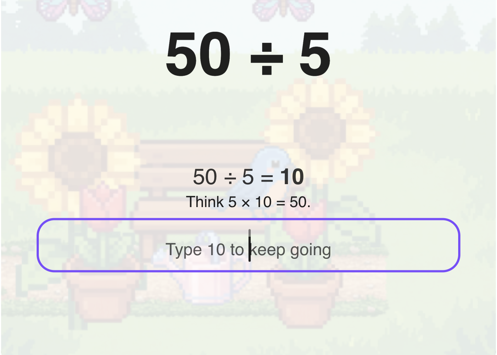
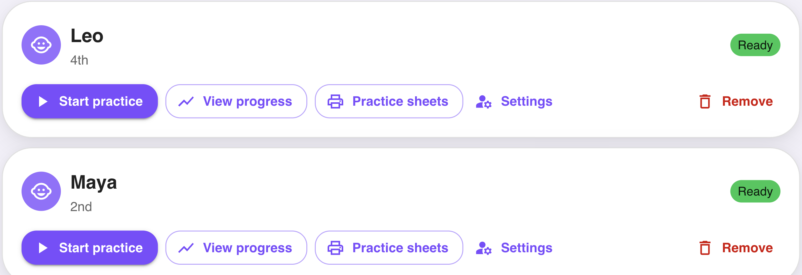
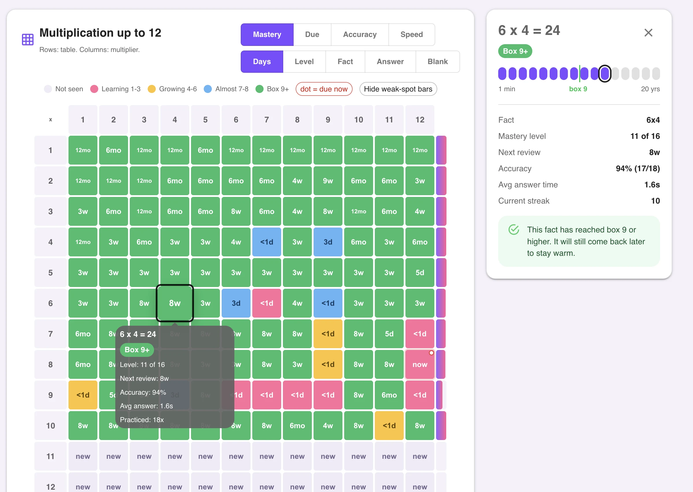
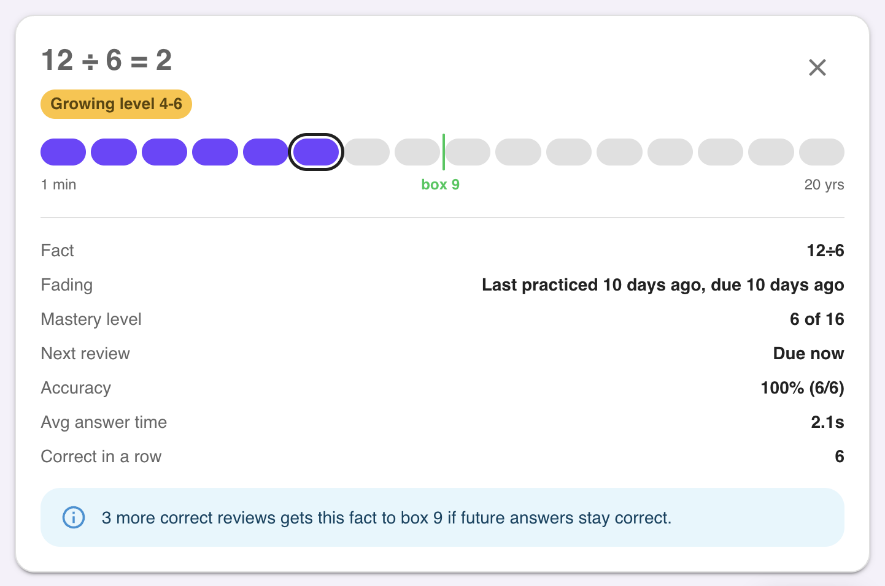
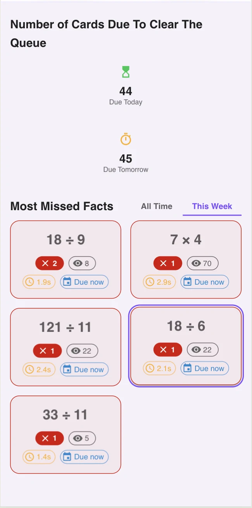
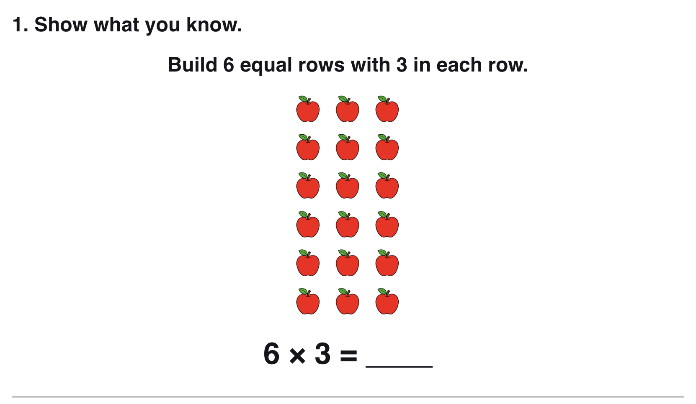
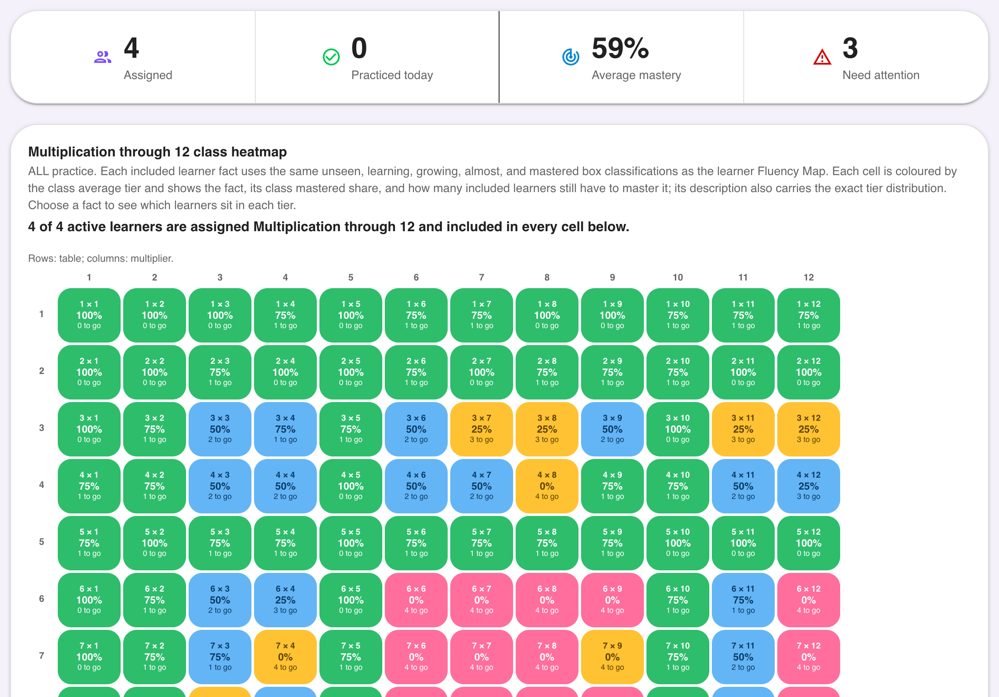

# Math Builders

**Short math fact practice for children, families, and classrooms.**

Math Builders is a web app for multiplication, division, addition, and subtraction practice. Children answer facts in short sessions. The app uses their answers and response times to choose what to review next. Parents and teachers can see progress for each learner and each fact.

[Try Math Builders](https://mathbuilders.com) · [Get a parent practice plan](https://mathbuilders.com/start-practice) · [For teachers](https://mathbuilders.com/teachers) · [More questions](docs/math-builders-faq.md)

*An actual app screen with sample data. A missed fact gets an answer and a connection to a related fact. The screenshots illustrate product features. The figures shown are examples, not claims about learning results.*

## What is a good way to memorize multiplication tables?

Start with what multiplication means. Use equal groups, objects, or rows of dots. Then practise recalling a few facts at a time, check the answers, and review them again on later days.

1. **Build from facts the child knows.** For example, use 5 × 7 = 35 to work out 6 × 7 = 42.
2. **Connect the pairs.** Explain why 3 × 8 and 8 × 3 both equal 24.
3. **Ask for an answer before showing it.** This is retrieval practice: the child tries to remember, then checks.
4. **Mix familiar facts with facts that need work.** Use a small set so practice stays manageable.
5. **Return to the facts over time.** A correct answer today is a useful start. Recall on another day gives more information.

Math Builders supports the practice and review steps. It schedules individual facts from saved answers, so an adult does not have to sort a flashcard deck each day. See the [multiplication tables guide](https://mathbuilders.com/how-to-memorize-multiplication-tables) for more examples.

## What is Math Builders, and who is it for?

Math Builders is a math fact fluency tool for parents, homeschool families, teachers, and tutors. It is useful when a child has learned an operation but still needs practice recalling its facts. Older learners can also use it to review facts they find difficult.

It works alongside lessons that teach mathematical ideas and problem-solving. A child who does not yet understand equal groups needs that instruction as well as recall practice.

## Which math facts can my child practise?

Math Builders covers addition and subtraction within 20, multiplication, and related division facts. Multiplication packs include facts through 6 × 6, 12 × 12, and an extended 24 × 24 range. Mixed multiplication and division practice is also available.

Choose facts that match the learner's current work. Grade is a starting point, not a requirement to use a harder pack.

## How long should a child practise each day?

Try a short session of 2 to 5 minutes. Math Builders uses a two-minute daily practice target, with room for more practice when it suits the learner. This is a routine to try, not a promise that every child will learn in the same time.

Choose a familiar point in the day, such as after breakfast or at the start of a lesson. If the child is frustrated, stop and return to an example they understand.

## What if my child can work out the answer but cannot remember it quickly?

Use a known fact as a bridge. For 7 × 8, the child might use 5 × 8 + 2 × 8 = 56. Then return to 7 × 8 in a later short review.

Math Builders uses both accuracy and response time to help schedule practice. A slow correct answer can show that a fact needs more review. Response time alone does not measure a child's mathematical ability.

## How does spaced repetition work in Math Builders?

Spaced repetition means reviewing information on separate occasions. In Math Builders, each fact has its own review schedule. Facts answered accurately and quickly can move to longer intervals. Missed or slower facts can return sooner.

The child answers the questions; the app manages the schedule. Parents and teachers can use the progress views to see which facts need attention. A review date is a practice aid, not a prediction of the exact moment a child will forget.

## How can I see what my child needs to practise?

The fluency map shows progress by fact. Progress views also show practice history and facts that were missed. This helps an adult ask a specific question, such as “Would a picture help with 7 × 8?”

*Each child has a separate learner profile. This example shows the parent controls for two sample learners. Free accounts include saved practice and basic stats. Premium adds detailed reports and personalised practice sheets.*

Progress is most useful when viewed across several sessions. One good round does not prove lasting recall, and one difficult round does not erase earlier learning.

### What does Premium show in the fluency map?

Premium gives you the full fact-by-fact view. Switch between mastery, review timing, accuracy, and answer speed to see where practice can help. Select a fact to open its details.

*The map brings individual facts together in one view. Colours show learning stages, and due markers identify facts ready for review.*

*Open a fact to see its last practice, next review, accuracy, average answer time, and correct answers in a row. Here, 12 ÷ 6 has six correct answers but is due for another review. Correct answers and regular review both matter.*

### Which missed facts should we review next?

Premium's full missed-fact report shows the facts that need attention, with views for this week and all time. Use the answer times and review dates to choose a focused follow-up.

*See the actual facts behind a summary score, then choose what to explain or practise next.*

### Can Premium make a worksheet from my child's practice?

Yes. Premium includes personalised weak-fact worksheets with answer keys and Printables Lab. Use saved practice to choose work for one learner or several, then take the next activity onto paper.

*An example from Printables Lab. Visual questions give children space to connect an equation to equal groups. Printed answers do not automatically update app progress.*

## Can Math Builders fit into a classroom warm-up?

Yes. Teachers can use a short session as a bell-ringer, a station activity, or part of a small-group lesson. A teacher creates a class, adds learners, and shares the class link. When the class is open for practice, students select their name. The standard classroom path does not require student email addresses.

*The class fluency map helps a teacher choose facts for review. The numbers shown are sample data, not product outcome claims.*

A free teacher account includes one class for up to 30 learners, all six core fact packs, home cards, and basic progress reports. See the [teacher guide](https://mathbuilders.com/teachers) for setup steps. Math Builders supports the teacher's curriculum with focused fact practice.

## Can school practice continue at home?

Yes. Teachers can print home cards that help a parent connect to the learner's existing progress. The parent signs in and completes the claim process. The child can then continue at home with that learner record.

This gives families a shared starting point: the facts the child is already practising at school. See the [class-to-home questions and sample card](docs/math-builders-faq.md#how-does-a-home-card-work).

## What if timed practice makes my child uncomfortable?

Keep the session brief and let the child stop. Math Builders measures response time for review scheduling and provides an **End Session** control. Saved practice can inform the next session.

Start with facts the child understands. Treat mistakes as a reason to explain and review, not as a reason to extend the session. See the [guide to practice with less time pressure](https://mathbuilders.com/math-facts-without-timer).

## Are flashcards, worksheets, and games useful too?

Yes. Paper flashcards support spoken practice. Objects and drawings help explain a fact. Worksheets give children space to write. Games can provide another way to practise.

Math Builders adds automatic review scheduling and saved progress. Its public [printable resources](https://mathbuilders.com/printables) can support time away from a screen. The app also includes rewards and scene-building activities. Choose a mix that helps the child practise and understand the facts.

## Is Math Builders an alternative to XtraMath or Times Tables Rock Stars?

Yes, it is another option for math fact practice. Consider Math Builders if you want short sessions, a separate review schedule for each fact, and progress views for adults.

Try a session with the child before choosing a tool. Look at whether they understand what to do, can stop comfortably, and will return for another short session. There is no single best app for every learner. See the [multiplication app comparison](https://mathbuilders.com/best-multiplication-app-for-kids) for options to explore.

## How does Math Builders help parents encourage regular practice?

The parent home shows what changed since the last visit, which facts need another review, and a nearby goal for each child. A parent can start the next practice session from that view.

- **Notice progress.** See new learning and recent practice without comparing reports by hand.
- **Choose the next step.** Review facts that are due and work towards a small learning goal.
- **Make room for breaks.** Pause for a family break, then return with a clear next step.
- **Offer encouragement.** Leave a short note for the child to see when they practise.
- **Celebrate steady effort.** Print a certificate that recognises practice across several weeks.

These tools help parents support a routine that fits family life. A missed week does not reset an earned certificate level.

## How does Math Builders help teachers choose the next class activity?

The class view summarises progress since the teacher's last visit. It highlights facts that need review and shows a nearby class goal. Teachers can use this information to choose a short warm-up or small-group activity.

The practice overview accounts for school breaks. Printable consistency certificates recognise practice over time. Teachers can celebrate the class's effort and help learners return after a break.

## Is Math Builders free, and how much does Premium cost?

Yes. Math Builders has free parent, teacher, and tutor accounts. All prices below are in US dollars.

| Plan | Price | What it includes |
| --- | --- | --- |
| Free Parent | $0 | One child added by the parent, plus children connected through teacher home cards; six core fact packs, saved practice, and basic stats. |
| Parent Premium | $11.99/month or $99/year | Additional parent-created profiles, combined and through-24 packs, full fluency maps, detailed reports, and personalised worksheets. |
| Free Teacher | $0 | One class with up to 30 learners, six core fact packs, class sign-in, home cards, and basic reports. |
| Teacher Personal | $49/year | Teacher Premium paid by the teacher, with more class capacity, full map detail, expanded reports, and personalised worksheets. |
| School-Funded Classroom | $149/year | Teacher Premium for one teacher, paid by a school, PTA, or department. |
| Free Tutor | $0 | One tutoring group with up to 30 learners, six core fact packs, group sign-in, home cards, and basic reports. |
| Tutor Premium | $34.99/month, $199/year, or $499 every 3 years | More tutoring groups and roster capacity, combined and through-24 packs, full map detail, expanded reports, and personalised worksheets. |

Free accounts do not require a credit card. Parent Premium offers a seven-day free trial. After the trial, the chosen monthly or annual price applies. Cancel before the trial ends to avoid a charge. Parents who skip the trial and pay annually get 20% off the first year: $79.20, then $99/year. Subscriptions renew automatically and can be cancelled in Manage billing.

[Choose a plan](https://mathbuilders.com/pricing).

## Where can I find more help?

- [More product questions](docs/math-builders-faq.md): setup, home cards, progress, printables, and learning expectations.
- [Parent practice plan](https://mathbuilders.com/start-practice): a starting point for a family routine.
- [Teacher guide](https://mathbuilders.com/teachers): classroom setup and home practice.
- [Privacy information](https://mathbuilders.com/privacy): how the service handles information.
- [Contact support](mailto:support@mathbuilders.com): help with the product.

This is the public product guide for Math Builders. The application source code is maintained separately. A short text version is available in [llms.txt](llms.txt).
