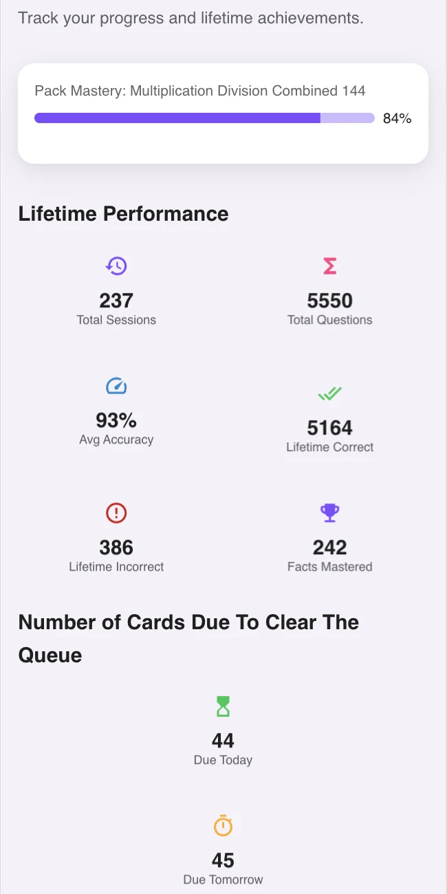
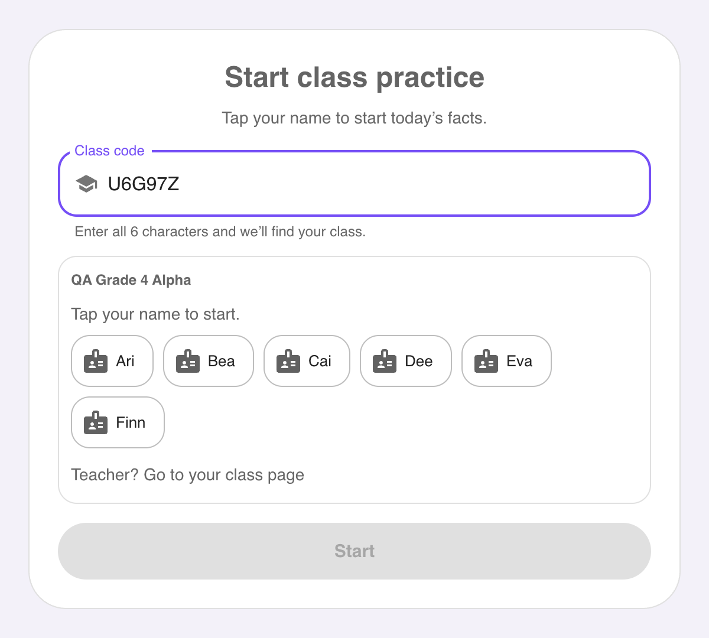
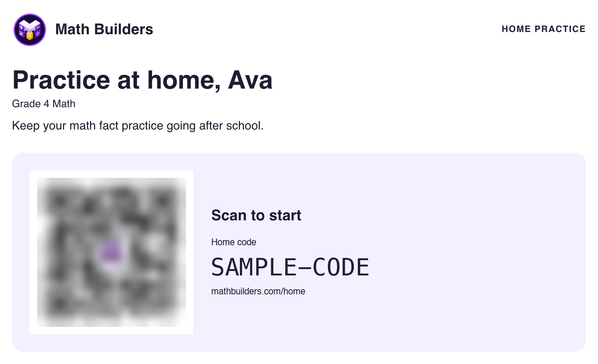

# More questions about Math Builders

Math Builders provides short practice sessions for multiplication, division, addition, and subtraction facts. This FAQ covers practical questions about using the product at home and at school.

[Main product FAQ](../README.md) · [Open Math Builders](https://mathbuilders.com) · [Plans and prices](https://mathbuilders.com/pricing)

## How can I help my child learn the harder times tables?

Choose a few facts that need work and connect them to known facts. For example, 8 × 7 is twice 4 × 7. Draw the groups if the connection is unclear. Ask for the answer again later, then mix that fact with familiar ones.

Math Builders can manage the review schedule after the child understands the idea. More questions in one sitting are not always the next useful step.

## Does my child need to know multiplication before using Math Builders?

A child needs an introduction to what multiplication means before recall practice is useful. Show equal groups or an array, and connect the picture to an equation. Math Builders then supports practice with those facts.

A child can also start with addition or subtraction. The app supports several operations, so multiplication need not be the first pack.

## How do multiplication facts help with division?

Related facts share the same numbers. If 6 × 7 = 42, then 42 ÷ 6 = 7 and 42 ÷ 7 = 6. Show the connection with objects or a drawing, then practise recalling each equation.

Math Builders includes division practice and mixed multiplication and division packs.

## How do I know whether practice is helping?

Look for accurate answers on different days and less need to count or reconstruct a fact. Ask the child to explain a connection too. Understanding and recall give different, useful information.

Math Builders provides fact-level progress and practice history. Use these as evidence for the next practice choice, alongside what you observe. A session score, forecast, or certificate does not guarantee a school result.

### What can I see in the Premium progress reports?

Premium adds full fluency map detail, all missed-fact detail, and expanded progress views. The dashboard brings pack mastery, practice totals, accuracy, and upcoming reviews together. These figures help you choose the next practice activity.

*An example progress dashboard. Read the summary alongside individual facts to understand where the learner needs help.*

See the [Premium fluency map, fact details, missed-fact report, and worksheet examples](../README.md#what-does-premium-show-in-the-fluency-map).

## How long will it take to learn all the multiplication tables?

There is no fixed time for every child. Prior knowledge, the facts being practised, and the practice routine all matter. Start with a manageable set and check what the child remembers on later days.

Math Builders does not promise mastery in a set number of days. Any progress forecast is an estimate based on practice, not a deadline for the child.

## Can siblings use Math Builders?

Yes. Each child has separate settings and saved progress. A free parent account includes one child added by the parent, plus children connected through teacher home cards. Parent Premium adds more parent-created profiles and costs $11.99/month or $99/year.

## Can I use Math Builders with a homeschool curriculum or tutoring?

Yes. Use it for a short fact review before or after a lesson. Keep the curriculum or tutor's explanations, problem-solving, and written work. Choose a fact pack that supports the learner's current lessons.

## How do students start practice in class?

The teacher creates the class, adds learners, and shares its link or code. The teacher opens the class for practice. Students then select their name. The standard classroom path does not require student email addresses.

*An actual app screen with fictional students and a sample class code. It illustrates the sign-in steps; it is not a class for visitors to join.*

## Does a teacher have to connect Google Classroom?

No. A teacher can add names manually and use a class link. Google Classroom roster import is an optional setup path and can depend on school permissions. Use the [teacher setup guide](https://mathbuilders.com/teachers) to get started.

## How does a home card work?

A teacher prints a home card for a learner and gives it to the family. The parent follows the link or scans the code, signs in, and connects to that learner. Home practice can then continue from the existing progress.

*Example only. Ava is a sample learner, and this card cannot connect a family to an account. Use the card supplied by the child's teacher.*

## Can we practise on paper?

Yes. Math Builders has public printable resources. Premium accounts can also create personalised practice sheets from saved practice, with answer keys. Printed answers do not automatically update the app's progress records.

Use paper for spoken practice, drawings, or written work when a screen is not useful. Visit the [printable resources](https://mathbuilders.com/printables).

## What happens if we miss a few days?

Start again with a short session. The app uses saved practice to choose reviews. A break does not mean a child has lost everything they learned.

Parents and teachers can set a break to pause the practice overview. On return, progress summaries and nearby goals help them choose a useful next session. See [family practice support](../README.md#how-does-math-builders-help-parents-encourage-regular-practice) and [classroom practice support](../README.md#how-does-math-builders-help-teachers-choose-the-next-class-activity).

## Can I encourage my child from the parent account?

Yes. Leave a short note for your child to see when they practise. The parent home also shows recent progress and the next goal, so you can recognise a specific effort. Printable consistency certificates celebrate practice across several weeks, with room for breaks.

## How much does Math Builders cost?

All prices are in US dollars.

- **Free Parent: $0.** One child added by the parent, plus children linked through teacher home cards.
- **Parent Premium: $11.99/month or $99/year.** Additional parent-created profiles, all fact packs, detailed progress, and personalised worksheets.
- **Free Teacher: $0.** One class with up to 30 learners.
- **Teacher Personal: $49/year.** Teacher Premium paid by the teacher.
- **School-Funded Classroom: $149/year.** Teacher Premium for one teacher, paid by a school, PTA, or department.
- **Free Tutor: $0.** One tutoring group with up to 30 learners.
- **Tutor Premium: $34.99/month, $199/year, or $499 every 3 years.** More groups and roster capacity, all fact packs, detailed progress, and personalised worksheets.

All free accounts include six core fact packs and basic progress reports, with no credit card required. Parent Premium has a seven-day free trial; the selected plan is charged after the trial unless cancelled. Parents who skip the trial and pay annually pay $79.20 for the first year, then $99/year. Subscriptions renew automatically; cancel in Manage billing.

[Choose a plan](https://mathbuilders.com/pricing).

## Where can a parent or school read about privacy?

See the public [privacy notice](https://mathbuilders.com/privacy), [COPPA information](https://mathbuilders.com/coppa), [FERPA information](https://mathbuilders.com/ferpa), and [terms](https://mathbuilders.com/terms). These pages provide the service's published information; a school can use them in its own review.

For account help or questions about a child's information, contact [support@mathbuilders.com](mailto:support@mathbuilders.com).
